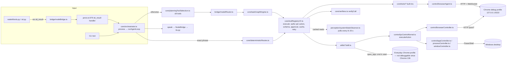

# JARVIS Tool Reliability & Portability Audit — 2026-10-25

> Report-only audit. No runtime code, tests, configuration or dependencies were changed; nothing was committed or pushed.
> Repository `miyakhelwaleedahmad/anti-gravity-for-jarvis-assistant`, branch `claude/jarvis-repair` at `e394a26`.
> Environment of every result unless stated: **cloud Linux 6.18 x86_64, Node 22.22.2, pnpm 10.33.0, no display, no audio, no PowerShell**. The audit's own probes used no real browser (a fake DevTools endpoint); the repository's `browserControlAgentTest`, run during the mutation stage, starts an isolated headless Chromium. Windows evidence is only Windows CI run #82 (counts read from its job log through the GitHub API: 204 passed / 0 failed / 6 skipped) and earlier owner reports; **nothing in this report was run on the owner's PC**.
> Probes and fault injection ran only in a scratchpad export of `e394a26` (`git archive`), with `node_modules` linked; every mutated file was restored and checked with `cmp`.
> This is a dated snapshot (`ai_workflows/_config/SOURCES_OF_TRUTH.md`, rule 4). The code wins.

## A. Executive summary

JARVIS has 79 tools (53 built-in, 26 skills), registered without duplicates and fully catalogued; the dispatch layer (permissions per action, approval gate, verification) is sound where it applies. The browser and app-closing problems the owner sees come from a small set of shared causes, not from one bug:

1. **JARVIS controls a different Chrome than the one it opens** (LIKELY, needs the PC). `open_app` opens pages in the default browser (the everyday Chrome profile) through `cmd /c start`; the tab tools only attach to a separately started debug profile on port 9222, and since Chrome 136 the everyday profile cannot be debugged at all (TRA-03).
2. **Closing apps by their common name cannot match** (CONFIRMED logic + vendor docs). `chrome`, `notepad` and `calculator` are rewritten to `chrome.exe`/`notepad.exe`/`calc.exe` and compared with Windows process names, which never contain `.exe` (TRA-04). "Close notepad" fails; focus and restart are affected too (restart opens a second instance).
3. **Tab requests can close whole windows** (CONFIRMED path, LIKELY in use). For "close the YouTube tab" the planner is offered `control_app` and `control_window` first; given "youtube" or "google chrome" they match by window title and close the whole Chrome window — `control_app` closes every matching window, in full control mode (risk 2) and without an approval prompt for non-protected apps (TRA-18).
4. **Most natural phrasings are not routed to a tab tool** (CONFIRMED). Only four exact phrases are deterministic; everything else goes to the LLM planner. Nothing can close all tabs, switch to the previous tab or close the browser as such (TRA-05, TRA-17).
5. **"Unavailable" looks like "nothing there"** (CONFIRMED). Without Chrome or PowerShell, several read tools answer an empty list or `false` with `success: true`; "is YouTube open?" then says "No"; `open_app` reports success off Windows without checking anything (TRA-07, TRA-08, TRA-09, TRA-19).

In addition: the tab tools pick a tab by list order with no intent check, and their check confirms only that *a* tab is gone (TRA-01/02, CONFIRMED logic; real Chrome lists the most recently active tab first, so the practical impact is lower). Named non-YouTube closes and "close current tab" need full control mode; empty-target and YouTube closes run at the default level (TRA-12). The kernel counts any returned text as success, and process kill reports success unconditionally (TRA-06, TRA-10).

What is **not** broken: no duplicate or shadowed tools; specialist scopes resolve; listeners are loopback-only; permission refusals are clear; retries never repeat a destructive action; the tab-close verifier does catch "not open" and permission texts. Windows CI #82 passed 204/0.

Nothing here is verified on the owner's PC; TRA-03 and the Windows effect of TRA-04 must be confirmed there before repairs start.

## B. Architecture map

## C. Tool inventory

Counting method: a probe wrapped `toolRegistryV2.register` before the orchestrator loaded, awaited the skills, and dumped every tool (raw: scratchpad `audit/out/inventory_linux.json`). 79 tools; 0 duplicate registrations; 0 tools missing from `core/toolCatalog.ts`; 0 orphan catalogue or verifier entries; every specialist/worker tool reference exists. No tool is gated by platform.

| Group | Tools | Registered by | Verification | Platform | Tests (files referencing) |
|---|---|---|---|---|---|
| Browser read | `browser_state`, `browser_read_page`, `browser_page_structure` | built-in | none needed (read) | any + debug Chrome | 4 / 1–2 |
| Browser act | `browser_navigate`, `browser_tab`, `browser_click`, `browser_type`, `browser_select`, `browser_scroll`, `browser_screenshot`, `browser_download`, `browser_upload` | built-in | own `verify` | any + debug Chrome | 1–6 each (`browserControlAgentTest`, real headless Chromium) |
| Browser via kernel | `control_browser` (list, focus, close, close_current, open_url, refresh) | skill | `verifyControlBrowser` | any + debug Chrome | 8 |
| Tab questions | `get_browser_tabs`, `is_tab_open` | skill | none; **read a 12 s poll snapshot** | any | 3, 2 |
| YouTube / site | `youtube_search`, `youtube_play`, `site_search`, `youtube_trending` | built-in | own `verify` (search/play) | any + debug Chrome | — |
| Apps | `open_app` | skill | `verifyOpenApp` (Windows; web pages unverifiable) | `start` / `open` / `xdg-open` | 27 |
| Apps / windows | `control_app`, `control_window`, `get_open_apps`, `get_active_window`, `is_app_open`, `windows_overview`, `ui_elements`, `ui_action`, `clipboard`, `screenshot` | skill / built-in | Windows-only checks | **Windows only** (PowerShell) | 1–11 |
| Input / process / system | `control_keyboard`, `control_mouse`, `control_process`, `control_system` | skill | **none on any OS** (static reason) | Windows only | 4–14 (dispatch, risk) |
| Files | `files`, `read_file`, `write_file`, `control_file` | built-in / skill | own `verify` / `VERIFIERS` | any | several |
| Terminal / dev / git | `run_command`, `get_system_info`, `dev`, `dev_status`, `diagnose_app`, `git`, `git_push`, `git_overview`, `github_search`, `github_repo` | built-in | exit code / own `verify` | any (+ network) | several |
| Memory / documents | `search_memory`, `save_relation`, `forget_memory`, `memory_brain`, `ingest_documents`, `search_documents` | built-in / skill | `VERIFIERS` (writes) | any | 1 each |
| Web | `web_search`, `deep_search`, `news_search`, `get_weather` | built-in / skill | none (query) | network | 1–2 |
| JARVIS itself | `list_capabilities`, `action_history`, `system_overview`, `get_system_state`, `get_pc_state` (0 tests), `get_jarvis_service_status`, `get_permission_status`, `enable/disable_full_control_session`, `cancel_current_action`, `self_check`, `self_repair`, `propose_code_repair`, `explain_code`, `data_tools` | mixed | mixed | any | 0–2 |
| Agents / goals | `delegate_task`, `agent_status`, `cancel_agent_task`, `goal_create`, `goal_status`, `goal_control` | built-in | mixed | any | 1 each |

Inconsistencies:
- Overlapping tools with different semantics: tab close (`control_browser close/close_current` vs `browser_tab close`), open a page (`open_app`, `control_browser open_url`, `browser_tab new`, `browser_navigate go`), list tabs (`get_browser_tabs` cached vs `browser_state` live vs `control_browser list`), app vs window close.
- 36 tools have no verifier entry (all low-risk reads; no write tool lacks one). `control_keyboard/mouse/process/system` have a static reason, so they are never verified, although the reason says "checked on Windows only".
- Windows-only tools are registered and offered to the planner on every OS.

## D. Prioritised findings

Classification: CONFIRMED / LIKELY / UNVERIFIED / ENVIRONMENT_LIMITATION / DESIGN_LIMITATION / NOT_A_BUG. "Direct" = observed in a run; "indirect" = code reading or vendor documentation.

| ID | P | Class / confidence | Finding | Evidence |
|---|---|---|---|---|
| TRA-01 | P2 | CONFIRMED logic / high; real-world wrong-tab impact LIKELY, low–medium | `control_browser close` with no target takes the first listed tab; a name matching several tabs takes the first match; no intent check, and the verifier confirms only that the closed id is gone. Real Chrome sorts `/json/list` by last activity (most recent first), so this is usually the last-used tab — wrong with several windows, a debug and an everyday Chrome, or a background YouTube tab used more recently | `control/browserController.ts:66-81` (`''.includes` matches all), `:117-148`; `core/verifiers.ts:156-191`; fake-CDP S1/S2 (hidden tab listed first) vs reviewer re-run with activity order: the visible / last-active tab closed; Chromium `devtools_http_handler.cc` `RespondToJsonList` sorts by `GetLastActivityTime()` (main branch); repo comments `cdpClient.ts:61`, `browserState.ts:76` |
| TRA-02 | P3 | CONFIRMED logic / high; impact low | With no visible tab (Chrome minimised), "close current tab" and `browser_tab close` fall back to the first listed tab — with activity ordering, the last-used tab, which is usually what was meant; reported verified | `perception/browserState.ts:77` (`?? tabs[0]`), `:82-92` (`?? pages[0]`); `browserController.ts:150-153`; probes S5, S7, reviewer R6 |
| TRA-03 | P1 | LIKELY / medium (indirect) | Tabs JARVIS opens are in the default browser (everyday Chrome profile), which its tab tools cannot see; named closes and tab questions then act on, or report about, the debug Chrome. When no debug Chrome is reachable, "close current tab" falls back to Ctrl+W on whatever browser window is in front (unverified, counted as success) — that can work against the everyday Chrome, unchecked | `skills/automation/skill.ts:26-47` (`cmd /c start`, default browser); `perception/cdpClient.ts:14-20` (attach-only); `browserController.ts:155-161` (Ctrl+W), `:184-188` (falls back to `start`); `verifiers.ts:169`; Chrome 136: [Chrome blog](https://developer.chrome.com/blog/remote-debugging-port). Needs the owner's PC |
| TRA-04 | P1 | CONFIRMED logic / high (indirect for Windows effect) | `control_app close/focus` for `chrome`, `notepad`, `calculator` never match: aliases add `.exe`, `ProcessName` has none; window titles do not contain "notepad.exe"/"chrome.exe". The deterministic "close notepad" route fails; `restartApp` swallows the no-match error and opens a **second** instance; `is_app_open` (tasklist with `.exe`) says true while close says no match. The verifier's own matcher strips `.exe` — `closeApp` does not | `control/appController.ts:16-23, 92-128, 136-141, 160-176, 186-195`; `openApps` sources: inline script `perception/windowsState.ts:95-96` (primary; also only the first 20 windowed processes), `get_windows_state.ps1:37`, `windows_probe.ps1:124-129`; `core/verifiers.ts:290-293`; [.NET `Process.ProcessName`](https://learn.microsoft.com/en-us/dotnet/api/system.diagnostics.process.processname?view=net-8.0); probe `close_app.json` |
| TRA-05 | P1 | CONFIRMED / high (direct) | Natural phrasings miss the deterministic routes; for "close this tab" the planner is offered `control_app` and `control_window` before `browser_tab`/`control_browser`; "close all tabs" gets no `control_browser` | `core/deterministicRoutes.ts:200-211`; `core/planningToolSelection.ts:115-137`; probes `routes.json`, `planner_tools.json` |
| TRA-06 | P2 | CONFIRMED / high (indirect) | `control_process kill` kills the first process whose name contains the text (substring), `Stop-Process -Force` with `reject:false`, and returns "Successfully terminated" unconditionally; no verifier. Approval is asked first and names the process and PID; protected names are refused; reachable only through the planner | `control/processController.ts:57-84`; `core/verifiers.ts:381-405` |
| TRA-07 | P2 | CONFIRMED / high (direct) | Unavailable reported as empty success: `get_open_apps` `[]`, `get_active_window` empty, `is_app_open`/`is_tab_open` `false`, `get_browser_tabs` `[]`; `getWindowsState` returns `EMPTY_RESULT` on any session failure; tab questions read a 12 s poll snapshot. "Is YouTube open?" answers "No" | probe `read_tools_linux.json`; `perception/windowsState.ts:405-410, 445, 481`; `skills/is_tab_open/skill.ts`, `skills/get_browser_tabs/skill.ts`; `perception/systemStateObserver.ts:34`; `core/orchestrator.ts:714-716` |
| TRA-08 | P2 | CONFIRMED / high (direct) | `self_check`'s "tools" item reflects whichever tool last succeeded ("working (list_capabilities ran)", or self_check itself), not a capability check; "tool_registry VERIFIED — 79 tools registered" is a count; Redis VERIFIED on the in-memory fallback; no item for CDP, PowerShell, desktop session or permission level (`get_system_state` / `get_pc_state` do report Chrome `running:false` honestly) | probe `read_tools_linux.json` |
| TRA-09 | P2 | CONFIRMED / high | No capability model: all tools registered and offered on every OS; `list_capabilities` has no availability | registry/planner/skill loader have no `process.platform` check; inventory probe |
| TRA-10 | P2 | CONFIRMED / high | The kernel marks any returned string `success: true`; caught later only where a verifier exists; `control_keyboard/mouse/process/system` are never verified on any OS | `control/pcControlKernel.ts:44-90`; `core/verifiers.ts:194, 381-405`; mutation MF |
| TRA-11 | P2 | CONFIRMED / high | Two `findTab` implementations with different defaults and match order; two tab-close tools; tab state read cached in one tool and live in another | `browserController.ts:66-81` vs `browserState.ts:82-92`; inventory |
| TRA-12 | P2 | DESIGN_LIMITATION | Tab-close permission is uneven: `close_current`, `browser_tab close` and named non-YouTube closes are risk 2 (full control mode, at most 30 minutes); empty-target, `about:blank` and YouTube closes are risk 1 and run at the default level — so the exact "close youtube" route and the empty-target path of TRA-01 work without full control while "close current tab" does not | `security/riskEngine.ts:226-229`, `control/browserController.ts:119-120`, `tests/riskEngineTest.ts:133`; `control/permissionSession.ts:74`; probe `fake_cdp_level0.json` (labelled "level 0", actually base level 1) and reviewer re-run R1–R3 |
| TRA-13 | P3 | CONFIRMED / high | Kernel action log fields are hard-coded and written as success before verification; disagrees with the trace log | `control/pcControlKernel.ts:75-87, 105-118` |
| TRA-14 | P3 | CONFIRMED / high (direct) | Voice normalisation removes "." so "open github.com" becomes "open githubcom" | `core/voiceInput.ts:14, 26`; probe `routes.json` |
| TRA-15 | P3 | LIKELY / medium | Test Chromium processes survive on Windows (`proc.kill()` ends the parent only): CI "Terminate orphan process: chrome" ×2 | `tests/chromeHelper.ts:100-135`; CI run #82 log |
| TRA-16 | P3 | CONFIRMED / high | Chrome start instructions are Windows-only text on every OS | `browserController.ts:41`, `perception/chromeState.ts:71`, `cdpClient.ts:39` |
| TRA-17 | P2 | DESIGN_LIMITATION | No "close the browser / all tabs" with defined meaning, no "previous tab", no JARVIS-owned browser lifecycle (attach only, no launch, no reconnect) | `skills/control_browser`, `core/tools/browserActionTools.ts`, `control/browserAgent.ts` |
| TRA-18 | P1 | CONFIRMED path (probe) / LIKELY in use (planner choice inferred) | Window-level tools close whole browser windows when given a tab or site name: `control_app close "youtube"` / `"google chrome"` / `"edge"` match by window title and close **every** matching window (in full control mode (risk 2), then without an approval prompt unless the app is protected; `riskEngineTest.ts:172-174`); `control_window close "chrome"` matches `ProcessName` and closes one Chrome window. The planner offers both first for "close the YouTube tab" | `control/appController.ts:109-126`; `control/windowController.ts:21-26`; probe `close_app.json` (matched and reached the close script); `planner_tools.json` |
| TRA-19 | P2 | CONFIRMED / high (code) | `open_app` reports success about 50 ms after spawning the opener without checking its exit; off Windows its verifier returns `unverifiable`, which counts as success; on Linux most allow-list targets resolve to Windows names (`chrome.exe`, `notepad.exe`, `ms-settings:`, `shell:Downloads`) that `xdg-open` cannot open | `skills/automation/skill.ts:56-82`; `core/verifiers.ts verifyOpenApp`; `core/toolRegistryV2.ts:1156-1159`; `security/openAppPolicy.ts:34-50` |

Root causes (grouped; smallest set covering most symptoms):

| RC | Root cause | Findings |
|---|---|---|
| RC1 | No browser-session model: attach-only to a profile JARVIS does not start, while `open_app` uses another | TRA-03, 16, 17 |
| RC2 | Name normalisation between layers (`.exe` aliases vs `ProcessName`) | TRA-04 |
| RC3 | Intent routing coverage and tool ordering: tab requests reach app/window tools that match by title | TRA-05, 14, 18 |
| RC4 | Registration treated as capability; unavailable reported as empty or unchecked success | TRA-07, 08, 09, 19 |
| RC5 | Success semantics at the kernel (strings = success, no verifier for some writers) | TRA-06, 10, 13 |
| RC6 | Target resolution without intent; the verifier checks the action, not the intent | TRA-01, 02, 11 |

Prioritisation rationale: P1 = a core command does the wrong thing or nothing on the owner's PC (TRA-03, 04, 05) or closes far more than asked (TRA-18). P2 = misleading signals, uneven permissions and logic defects whose real-world impact is limited by Chrome's activity ordering or by an approval prompt (TRA-01, 06–12, 17, 19). P3 = low-impact or diagnostic (TRA-02, 13–16). No P0: no security boundary is broken; process kill and protected-app close ask for approval.

Per finding — repair direction (smallest) and regression test:

| ID | Smallest repair direction | Regression test |
|---|---|---|
| TRA-01 | No target → the visible tab or refuse; several matches → ask; never "first match"; verifier compares the closed tab with the intended one | fake CDP: two YouTube tabs, one visible; no-target close; assert the visible one closed or a question |
| TRA-02 | No visible tab → say which tab will be closed (the last used) or ask | fake CDP with no visible tab: "close current tab" names the tab it will close (the last used) or asks, and closes nothing else |
| TRA-03 | Decide one browser model (Decision D1); then open pages through CDP in the controlled profile | owner's PC: open YouTube, then "close the YouTube tab" closes it |
| TRA-04 | Compare without `.exe` (normalise both sides, as `appWindowMatcher` does); restart must not open a second instance when close found nothing | closeApp/focusApp with `{name:'chrome'|'notepad'}` windows match; restart with no match does not open twice |
| TRA-05 | Deterministic patterns for the common phrasings; offer tab tools before app/window tools when the request names a tab | route probe phrases → `close_current_tab` / `close_browser_tab`; planner offers `browser_tab` first |
| TRA-06 | Kill by PID JARVIS identified with the user, check the exit code, verify the process is gone | stub execa failure → not "Successfully terminated" |
| TRA-07 | Return `unavailable` (with reason) when the source cannot be read; tab questions read live state | CDP down → `is_tab_open` is not `false`; PowerShell down → `get_open_apps` is not `[]` |
| TRA-08 | Separate "a tool ran" from per-capability checks (CDP, PowerShell, permission) | self_check on a host without PowerShell shows desktop control unavailable |
| TRA-09 | Capability record per tool (`requires`, `platforms`) used at planning and dispatch | Linux: planner never offers `control_window` |
| TRA-10 | Kernel: a controller returns a typed outcome, never a free-text success | controller returns "not open" → `success:false` |
| TRA-11 | One tab resolver used by both tools | both tools pick the same tab for the same input |
| TRA-12 | Owner decision (Decision D2) | — |
| TRA-13 | Log the user's request id and the verified outcome | trace and action log agree after a VERIFICATION_FAILED |
| TRA-14 | Keep `.` inside domain-like words | "open github.com" keeps the domain |
| TRA-15 | Kill the test browser's process tree | Windows CI: no orphan chrome |
| TRA-16 | Platform-specific instructions | Linux error names `google-chrome`/`chromium` |
| TRA-17 | Design (Decision D1/D3) | — |
| TRA-18 | Tab/site names never reach window-closing tools: route "… tab" requests to tab tools; `control_app close` closes one window unless "all" is said, and asks when several match | planner offers tab tools first for "close the YouTube tab"; closeApp with two matching windows asks |
| TRA-19 | Check the opener's exit; report `unverifiable` web opens as "opened, not checked", never as checked success; gate Windows-only targets | Linux: `open_app notepad` is refused as unsupported; spawn failure → not success |

## E. Browser-tool investigation

Command semantics (intended → actual, cloud Linux probes + code):

| Command | Route | Tool path | Actual behaviour |
|---|---|---|---|
| "Close this tab" | planner | LLM choice among `control_app`, `control_window`, `browser_tab`, `control_browser` | may close a whole window (TRA-18); with a tab tool, the visible tab or the last-used one; permission depends on the tool chosen: empty-target `control_browser close` runs at the default level, the others need full control (TRA-12) |
| "Close the current tab" | planner | same | same |
| "close current tab" (exact) | deterministic `close_current_tab` | `control_browser close_current` → visible tab | correct when a tab is visible in the debug Chrome; last-used tab when none is; needs full control; Ctrl+W on the front browser window when no debug Chrome (unchecked, TRA-03) |
| "Close the YouTube tab" | planner | `control_browser close "youtube"` **or** `control_app/control_window close "youtube"` | tab tool: most recently active YouTube tab, default level; app/window tool: **every Chrome window whose title contains "YouTube"** (TRA-18); invisible if YouTube is in the everyday profile (TRA-03) |
| "close youtube" (exact) | deterministic `close_browser_tab` | `control_browser close "youtube"` | runs at the default level (risk 1); tab-level, debug Chrome only |
| "Close the browser" / "Close Chrome" | planner | `control_app close chrome` or `control_window close chrome` | `control_app`: never matches (TRA-04); `control_window`: closes one Chrome window (`ProcessName` match); "close google chrome" via `control_app`: every Chrome window (TRA-18); no defined "close browser" action (TRA-17) |
| "Close all tabs" | planner | no capable tool | cannot be done |
| "Switch to the previous tab" | planner | `browser_tab switch` needs a name | no notion of the previous tab |
| "Open YouTube for me" | deterministic `open_app` | `cmd /c start https://www.youtube.com` | opens in the everyday profile (TRA-03) |
| "Open another website" / "open github.com" | planner | `open_app`, `browser_navigate` | "github.com" loses its dot in normalisation (TRA-14) |
| Browser closed, recover | planner | none | every call fails with `CdpUnavailableError`; no launch or reconnect |

Discovery and attachment: attach-only to `http://127.0.0.1:${JARVIS_CDP_PORT:-9222}` (`cdpClient.ts:14-20`); `/json/list`, `/json/new` (PUT), `/json/close/<id>`, page WebSockets checked to be local (`localSocketUrl`). No Playwright or Puppeteer is used (the Playwright documentation does not apply). No launch, no user-data-dir handling, no reconnect; Windows-only start instructions. Since Chrome 136 the port works only with a non-default `--user-data-dir` ([Chrome blog](https://developer.chrome.com/blog/remote-debugging-port)).

Close-tab correctness (fake CDP, real `toolRegistryV2.execute`, full control on):

| Case | Closed | Result |
|---|---|---|
| S1 `control_browser close`, no target, C3 visible | A1 (first) | verified ✗ wrong tab |
| S2 `close "youtube"`, C3 visible | B2 (first match) | verified ✗ wrong tab |
| S3 `close_current`, C3 visible | C3 | verified ✓ |
| S4 `browser_tab close`, C3 visible | C3 | verified ✓ |
| S5 `browser_tab close`, none visible | A1 | verified ✗ wrong tab |
| S6 `close "current tab"` | none | VERIFICATION_FAILED (honest) |
| S7 `close_current`, none visible | A1 | verified ✗ wrong tab |
| Default level 1 (no full control): `close "gmail"`, `close_current`, `browser_tab close` | none | PERMISSION_DENIED "needs full control mode" |
| Default level 1: `close` no target / `close "youtube"` (reviewer re-run) | A1 / B2 | verified — risk 1, runs without full control |
| Activity-ordered list (C3 first), full control (reviewer re-run): no target / `"youtube"` / `close_current` with none visible | C3 each time | verified — the last-used tab |

Close-browser semantics: the code does not distinguish one tab / one window / a JARVIS-owned instance / disconnect / all tabs / force-kill — tab close, app close (all matching windows), window close (one window) and process kill are separate tools that do not know about each other. Disconnect is never reported as "browser closed" (there is no disconnect). `control_process kill chrome` would end one chrome process chosen by name (first match) after approval (TRA-06).

State and concurrency: per-tab turn queue (`cdpClient.ts:190`), serialised kernel actions, stale element references refused when the page URL changed. Multiple windows/profiles, pinned tabs, crash mid-call, restart: **NOT RUN** (no real browser here).

## F. Test-quality assessment

Mutation run, each fault alone, command `python3 audit/tools/mut_suite.py <export> <repo> <tests> …` (raw `audit/out/mutation_suite.txt`) over 16 tests: browserControlAgentTest, browserControlTest, browserObservationTest, closeAppRouteTest, deterministicCommandRouteTest, dispatchAuthzTest, errorRecoveryTest, executionDispatchAuditTest, navigationPolicyTest, registryRepairHonestyTest, routeGoldenTest, scenarioIntegrationTest, systemStateRouteTest, taskFailureHonestyTest, toolDiscoverabilityAuditTest, verifyAfterActTest. Control 16/16. The reviewer re-ran MB, MD and ME against an overlapping set of 17 tests (adds selfCheckTest, windowsToolsTest, chromeStateSmokeTest, riskEngineTest, backgroundResearchTest; leaves out deterministicCommandRouteTest, registryRepairHonestyTest, routeGoldenTest, taskFailureHonestyTest): still undetected across the union of 21 tests. Detected: MA (control_browser close skipped), MC (route misrouted), MF (kernel success on throw — by one test), MG (`reportedFailure` disabled — 5 tests). **Not detected:** MB (tab resolver ignores the visible tab), MD (tab-close verifier always "verified"), ME (`browser_tab close` does nothing).

Weak patterns:
- `closeApp` is stubbed or tested only for protection; its matching never runs with real window data (TRA-04 invisible).
- The real-browser close test has one visible tab and one "not open" case; no empty target, several matches, or nothing visible (TRA-01/02 invisible).
- `browser_tab close` is never run against a real tab.
- Health that is not a capability check: `self_check`'s "tools VERIFIED" reflects whichever tool last succeeded (TRA-08).
- No platform/e2e test of "unavailable vs empty" for read tools.
- `voiceRouteMockTest` (TEST-06) proves bridge → route → dry run in a test; it does **not** prove real browser control, the live microphone or spoken output.

Proposed contracts (not implemented): close one tab ≠ close browser; close tab ≠ disconnect; close managed browser ≠ kill user browser; dispatch success ≠ verified result; recoverable ≠ irrecoverable connection failure; unavailable browser ≠ false success; no-name or ambiguous target → visible tab or a question, never "first".

## G. Cross-platform matrix

Legend: Works+evidence / Works w/ config / Needs adapter / Needs local agent / Headless only / Unsupported / Unverified.

| Capability | A. Owner's Windows PC | B. Other Windows laptop | C. Linux desktop | D. Headless VPS | E. Container/WSL | F. Cloud + local agent |
|---|---|---|---|---|---|---|
| Voice (wake/STT/TTS) | Works w/ config (live unverified) | Works w/ config (unverified) | Unverified | Unsupported (no audio) | Unverified | Needs local agent |
| Browser read/act (CDP) | Works w/ config (debug Chrome by hand); CI evidence for headless | Works w/ config | Works w/ config | Headless only | Unverified (WSL2 loopback differs) | Needs local agent |
| Tab close by intent | Unverified; defects TRA-01/02/03/18 | same | same | Headless only | Unverified | Needs local agent |
| `open_app` | Unverified live (`JARVIS_CURRENT_STATUS.md`: "not established"); route and dry run tested | Unverified | Unverified: most app targets cannot work (Windows allow-list), URLs maybe; reports success unchecked (TRA-19) | Unsupported | Unverified | Needs local agent |
| App/window/process/keyboard/mouse/clipboard | Works w/ config (Windows CI tests; `verify:windows` owner-reported at older commit `ee1c8c8`, 16 passed / 1 failed, `docs/remediation/TEST_RESULTS.md:56-69`, not re-run at `e394a26`); close-by-name defect TRA-04 | Works w/ config | Needs adapter | Unsupported | Unverified | Needs local agent |
| Files, git, dev, terminal | Works + evidence on Windows CI; owner PC unverified | Unverified | Works + evidence (cloud suite, run in a Linux container) | Unverified | Works + evidence for a Linux container (same cloud run); WSL unverified | Needs local agent for the PC's files |
| Memory, web search, agents | Unverified (needs provider key; vector service FAILING in the cloud probe) | Unverified | Unverified (tests with scripted model pass) | Unverified | Unverified | Coordinator-side possible |

Portability details: no hardcoded drive letters or usernames; ports overridable (`BRIDGE_PORT`, `HEALTH_PORT`, `JARVIS_CDP_PORT`, Redis); Python path per platform; 19 files outside tests/docs/_legacy mention `powershell`/`cmd.exe`/`pwsh` literals (search `grep -rlE "'powershell'|\"powershell\"|'cmd.exe'|powershell.exe|pwsh"`, including `scripts/` and policy files; the reviewer's narrower search found 16 that spawn); no tool gating; Windows-only Chrome instructions; all listeners loopback-only; remote access hard off.

## H. Recommended target architecture

Smallest adaptation (no rewrite), in order:

1. **Capability record per tool** on the existing `ToolMeta`: `platforms`, `requires` (`cdp`, `powershell`, `display`, `audio`, `network`, `provider`), `permissionLevel`. Checked at planning (`selectPlanningToolNames` offers only available tools) and at dispatch.
2. **Capability states** (from the checks above, cached briefly, refreshed on failure): `available | degraded | unavailable | unsupported | permission_denied | disconnected`, each with `reason` and `howToEnable` (e.g. "start Chrome with `--remote-debugging-port=9222 --user-data-dir=<folder>`", "say 'enable full control mode'", "needs Windows"). `self_check` and `list_capabilities` report these instead of "tools: VERIFIED".
3. **Action-verification contract**: every acting tool returns `{ outcome: 'done' | 'not_done' | 'refused' | 'unavailable', target: <resolved id + title>, evidence }`; the kernel never turns free text into success; the verifier checks the *intended* target (the id resolved before acting, from the user's words or the visible tab), not merely "some id is gone".
4. **One browser session model** (owner decision D1): either JARVIS starts and owns a debug-profile Chrome (and `open_app` web targets go through CDP into it), or JARVIS only attaches and says so when the page is not in that browser.
5. **Later, only if the cloud coordinator is wanted**: a local agent on the PC exposing the same capability records over an authenticated channel (the groundwork in `security/remoteAccess.ts` and `docs/remediation/REMOTE_ACCESS.md` already defines the rules). Not needed for the current single-PC use.

## I. Repair roadmap

| Phase | Findings | Code areas | User improvement | Risks | Tests | Environment verification | Exit criteria |
|---|---|---|---|---|---|---|---|
| 1. Close by name, and no whole-window close for tab requests | TRA-04, 18, 06 | `appController.closeApp/focusApp/restartApp`, `windowController`, `processController.killProcess`, verifiers; for TRA-18 also `planningToolSelection.ts`, `deterministicRoutes.ts` (tab requests reach tab tools) | "close notepad/Chrome" works; kill reports truth | closing more windows than intended (all matches) | real-shaped window data; execa failure | Windows CI + owner PC (Notepad) | "close notepad" closes Notepad on the PC |
| 2. Browser session (after D1) | TRA-03, 16, 17 | `open_app` web path, `cdpClient`, a launcher if D1 = own | open and close act in the same browser | changes how YouTube opens | owner-PC scenario: open → close | owner PC | open YouTube → close YouTube tab works live |
| 3. Routing | TRA-05, 14 | `deterministicRoutes.ts`, `planningToolSelection.ts`, `voiceInput.ts` | everyday phrasings work without the LLM | phrase collisions | route golden updates; planner order | cloud + live voice | probe phrases route correctly |
| 4. Safe targeting | TRA-01, 02, 11 | `browserController.findTab/closeTab/closeActiveTab`, `browserState.findTab/readBrowserState`, `verifyControlBrowser` | "close the tab" never closes the wrong tab | refusing more often | fake-CDP contracts (multi-match, none visible, empty target); MB/MD/ME mutations must fail | cloud + Windows CI; owner PC with a debug Chrome | all contracts pass; mutations MB, MD, ME detected |
| 5. Honest capability | TRA-07, 08, 09, 10, 12, 19 | registry meta, read skills, `self_check`, kernel | JARVIS says "Chrome is not reachable / needs Windows / enable full control" instead of "no" | many tests assert old outputs | unavailable-vs-empty contracts | cloud (Linux) + Windows CI | no read tool reports empty when its source failed |
| 6. Diagnostics | TRA-13, 15 | `actionAuditLog`, `pcControlKernel`, `chromeHelper` | one request traceable end to end | log format change | trace/action log agreement; CI orphan check | Windows CI | no orphan chrome; logs agree |

Order follows the impact on the owner's PC and dependencies; it was changed after review round 1 (the wrong-tab cases are less likely with Chrome's activity ordering; the whole-window close was added).

## J. Verification limitations and open questions

- Nothing ran on the owner's PC. TRA-03 (session mismatch) and the Windows effect of TRA-04 are inferred from code and vendor documentation.
- The audit's probes used a fake CDP endpoint, not a real browser. Real Chrome sorts `/json/list` by last activity, most recent first (Chromium `devtools_http_handler.cc`, main branch, not pinned to a version); the first fake ordering (hidden tab first) overstated the wrong-tab cases, corrected after review.
- Live voice, microphone and speakers were not exercised.
- Graphify's index is built from `main` (220 commits behind); all claims were checked in the local checkout.
- Open questions for the owner: which Chrome do you use while talking to JARVIS — one started with `--remote-debugging-port`, or the normal one? Do you usually run in full control mode?

## K. Independent review

Reviewer: a separate agent session (Claude), **not a human**; read-only on the repository, experiments in its own export.

Round 1 decision: **CHANGES REQUIRED**. Findings and how this report changed:

| ID | Severity | Point | Change made |
|---|---|---|---|
| R1 | high | Fake CDP listed the hidden tab first; real Chrome lists most recently active first (Chromium source, repo comments); with activity order the last-used tab closed | TRA-01 → P2 (logic CONFIRMED, impact LIKELY low–medium), TRA-02 → P3; summary, E, J, answers updated |
| R2 | high | Empty-target, `about:blank` and YouTube closes are risk 1 and run at the default level (`riskEngine.ts:226-229`); probe labels said "level 0" | TRA-12 rewritten; E table rows added |
| R3 | high | Missing: `control_app`/`control_window` close whole Chrome windows for "youtube"/"chrome"/"google chrome" | new **TRA-18 (P1)**; summary, E, answers updated |
| R4 | medium | TRA-04 holds; citations and scope (focus, restart opens a second instance, calculator, inline script, verifier strips `.exe`, `is_app_open` disagrees) | TRA-04 widened, citations fixed |
| R5 | medium | G labels overclaimed; `open_app` false success off Windows | G relabelled; new **TRA-19 (P2)** |
| R6 | medium | Ctrl+W fallback acts on the front browser window unverified; `start` uses the default browser | TRA-03, E updated |
| R7 | low | self_check "tools" item = last successful call | TRA-08 reworded |
| R8 | low | Test list of the mutation run not recorded | F updated |
| R9 | low | The repo's headless Chromium did run | header updated |
| R10 | low | TRA-06 P1 arguable (approval names PID) | TRA-06 → P2 |
| R11 | info | CI counts not independently readable by the reviewer | header cites the job log read through the GitHub API |
| R12 | info | 16 vs 19 PowerShell files | search pattern stated |
| R13 | info | Line references and inventory counts verified correct | — |

Experiments by the reviewer (its report): fake-CDP re-run at the default level and with activity ordering (cases R1–R6 above), mutations MB/MD/ME against 17 tests (undetected), Chromium `devtools_http_handler.cc` read (`TimeComparator`, `std::sort` in `RespondToJsonList`), GitHub API run #82 success.

Round 2 decision: **CHANGES REQUIRED** — R1–R12 confirmed fixed; text-only follow-ups, all made:

| ID | Severity | Point | Change made |
|---|---|---|---|
| R2-1 | medium | Answer 5 used the old RC numbers | renumbered (RC4, RC5, RC2) |
| R2-2 | medium | Section F still said "tools VERIFIED counts self_check's own run" | reworded to match TRA-08 |
| R2-3 | medium | TRA-18 omitted that `control_app close` needs full control (risk 2) | qualifier added in D and A |
| R2-4 | low | E "Close this tab": permission depends on the tool chosen | reworded |
| R2-5 | low | Roadmap rows out of order; TRA-18's planner/route files missing from phase 1 | rows in numeric order; files added |
| R2-6 | low | Reviewer's 17-test set overlaps, not adds | reworded (union 21 tests) |
| R2-7 | low | TRA-02 repair and regression test disagreed | regression test aligned |
| R2-8 | info | `verify:windows` is owner-reported at `ee1c8c8`, not CI | G cell reworded |
| R2-9 | info | The cloud suite ran in a Linux container | G row E updated |
| R2-10 | info | Priority counts consistent: P1 4, P2 10, P3 5 (19 findings) | — |
| R2-11 | info | Two scratchpad logs are not CI #82 evidence | not cited |

The reviewer independently read the CI #82 Windows job log in round 2: 204 passed / 0 failed / 6 skipped, and "Terminate orphan process … (chrome)" twice.

Round 3 decision: **PASS** — all round-2 fixes confirmed; two optional wording points, both made:

| ID | Severity | Point | Change made |
|---|---|---|---|
| R3-1 | low | Answer 11 said "anything on containers", while G claims files/git/dev/terminal work in a Linux container | narrowed to desktop/browser/voice on WSL/containers/VPS |
| R3-2 | info | G `open_app` column C said "app targets cannot work" | "most app targets cannot work" |

## Final decision answers

1. **Why "close the tab" fails.** Confirmed: "close current tab" and named non-YouTube closes need full control mode (TRA-12); most phrasings go to the planner, which is offered app/window tools first and can close a whole window instead (TRA-05, TRA-18). Confirmed logic, lower impact: the tab is picked by list order with no intent check (TRA-01/02). Likely, unconfirmed: the tab is in the everyday Chrome that JARVIS cannot see (TRA-03). Which of these happens on the owner's PC is **unknown** until it is run there.
2. **Why "close the browser" fails.** There is no defined "close the browser" action (TRA-17). `control_app close chrome` cannot match because of the `.exe` alias (TRA-04); `control_window close chrome` closes one window; `control_app close "google chrome"` closes every Chrome window (TRA-18). So the result depends on the words and the planner's choice.
3. **Mix:** routing and tool ordering (TRA-05, 18), implementation (TRA-04, 06, 19), session (TRA-03), platform (TRA-09), verification (TRA-01: checks the action, not the intent).
4. **Functional vs merely registered.** Functional with evidence (tests, cloud or Windows CI): browser read/act tools against a debug Chrome (headless Chromium), files/git/dev/terminal, routing, permission and approval. Registered but not proven working: tab close by intent, app close by common name, process kill, keyboard/mouse/system (never verified), `open_app` live, all Windows tools on non-Windows hosts, tab questions when Chrome is unreachable, memory/web/agents with a real provider.
5. **Cross-family problems:** RC4 (registration ≠ capability), RC5 (kernel success semantics), RC2 (name normalisation) affect browser, app, window and process tools alike.
6. **Other Windows laptops without code edits:** likely yes with configuration (Node, pnpm, `.venv`, `.env`, a debug Chrome); no drive letters or usernames are hardcoded (search above). Not run, so not claimed.
7. **Headless VPS controlling a physical Windows PC:** not possible today; every listener is loopback-only and remote access is hard off. A local agent on the PC (JARVIS's tools + an authenticated channel as in `REMOTE_ACCESS.md`) is required.
8. **Top root causes to fix first:** RC2 (close by name), RC3 (tab requests reaching window tools; routing), RC1 (one browser session), RC4 (honest unavailability), then RC6 (intent-checked targeting). Re-weighed after review: Chrome's activity ordering lowers RC6's practical impact.
9. **Repair order:** section I phases 1 → 2 (after D1) → 3 → 4 → 5 → 6.
10. **Tests that must pass before "fixed":** the seven browser contracts (section F), the close-by-name test with real window shapes, "close the YouTube tab" never reaching a window tool, mutations MB/MD/ME detected, Windows CI green, and an owner-PC run: open YouTube → "close the YouTube tab" → "close notepad".
11. **Must not be claimed working until tested:** live voice/browser on the owner's PC, tab close by intent, close Chrome/notepad, process kill, keyboard/mouse/system actions, `open_app` live, desktop/browser/voice on WSL/containers/VPS, Linux desktop tools.
12. **Decisions needing the owner's approval:** D1 browser model (JARVIS-owned debug Chrome vs attach-only); D2 tab-close permission: one level for every tab close (today YouTube/empty-target closes are level 1, others need full control); D3 whether "close the browser" should exist and what it may close (one window, all windows, a JARVIS-owned instance); D4 whether to start the repair phases, in the order above, each as its own ICM run.
